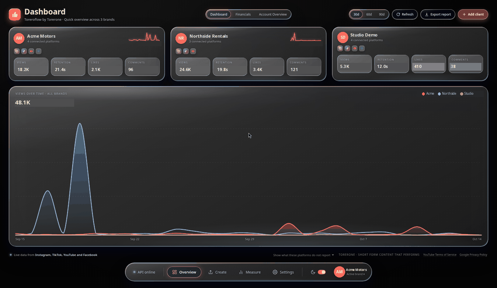
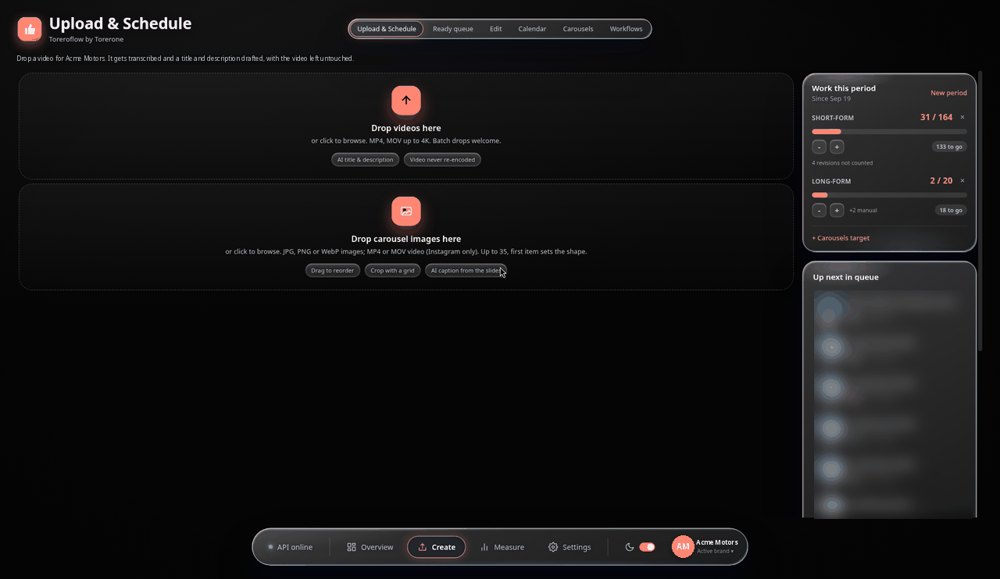
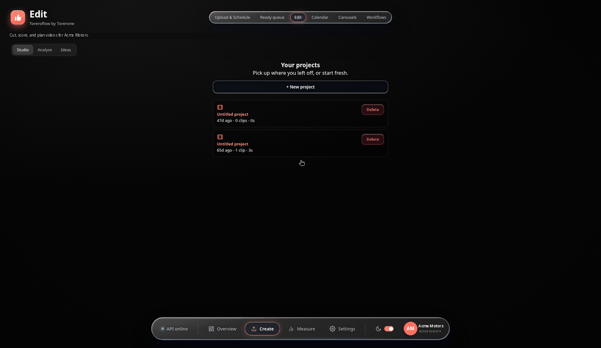
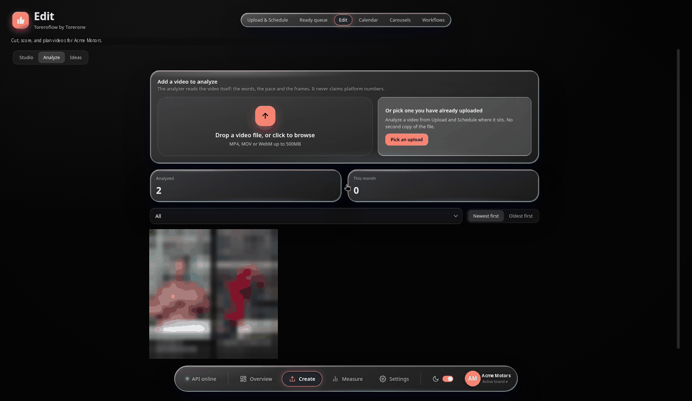
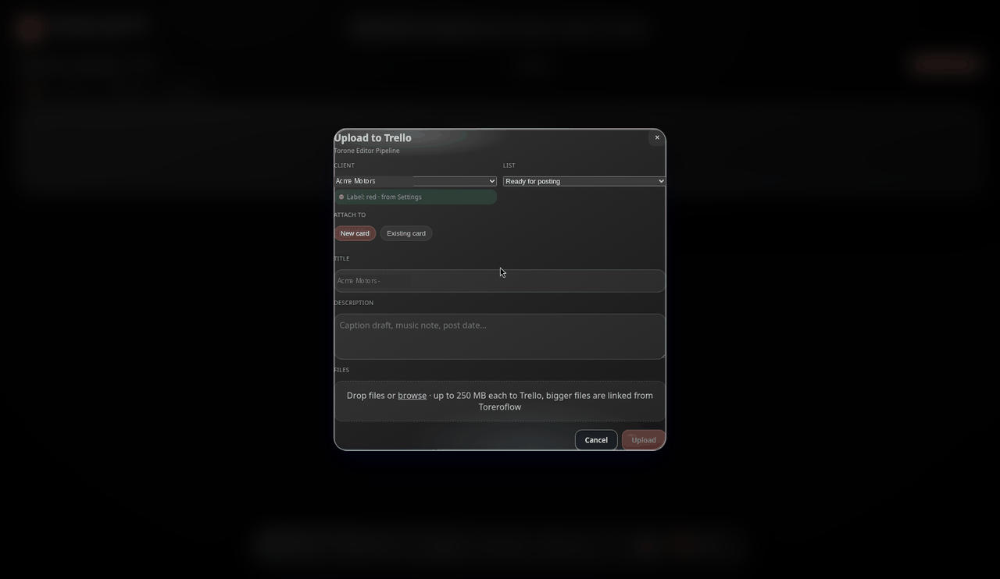
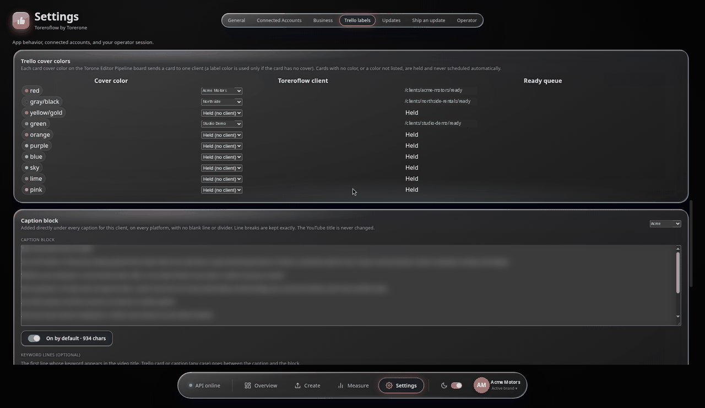
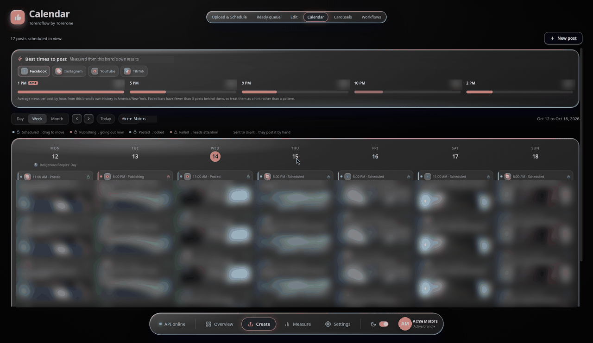
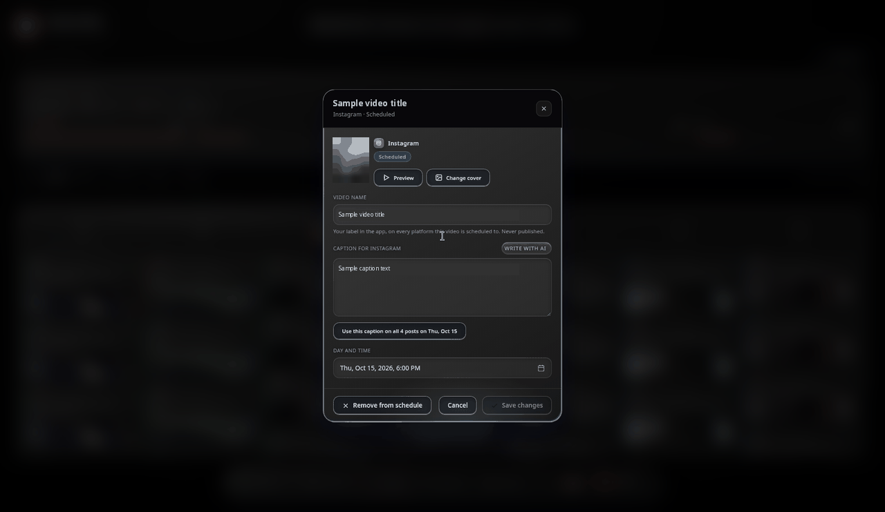

<div align="center">


# Toreroflow

**The command center for a short-form video agency, by Torerone**

Cut a video, schedule it to every platform, watch what it did, bill for it,
and hand the client something worth reading.

<br/>


<br/>



<sub>Screenshots use a placeholder brand. No client of ours appears in this repository.</sub>

</div>

---

## Contents

- [What's new (last few days)](#whats-new-last-few-days)
- [Features](#features)
  - [Dashboard](#dashboard)
  - [Create: upload and schedule](#create-upload-and-schedule)
  - [Edit: Studio, Analyze, Ideas](#edit-studio-analyze-ideas)
  - [Trello pipeline](#trello-pipeline)
  - [Caption block](#caption-block)
  - [Calendar](#calendar)
- [How it is put together](#how-it-is-put-together)
- [Releases and auto-update](#releases-and-auto-update)
- [Getting started](#getting-started)
- [AI-friendly: notes for coding agents](#ai-friendly-notes-for-coding-agents)
- [Changelog](CHANGELOG.md)

---

## What's new (last few days)

| Version | Date | What changed |
|---|---|---|
| **v0.3.25** | 2026-10-14 | **Caption block** per client: standing text and keyword lines added under every caption, on by default, composed server-side for every platform. YouTube title untouched. Human-only setting. |
| **v0.3.24** | 2026-10-14 | **Upload to Trello** from the Ready queue. Card moves to *Approved by Client/ uploaded* when the post is scheduled, with a Retry move button. Files over 250 MB go as a signed link. |
| **v0.3.23** | 2026-10-14 | **Cover-color client matching** for Trello cards (label only as a fallback). Glass default now 0.5. |
| PR #2 | 2026-10-14 | **Polly-friendly scheduling**: Ready queue, SOP page and reminder, Trello label map. |
| v0.3.17 - 0.3.22 | 2026-10-13 | Clear Glass / liquid glass redesign, Analytics v6, Account Overview carousel. |

Full details in [CHANGELOG.md](CHANGELOG.md).

---

## Features

### Dashboard

A quick overview across every brand: views, retention, likes and comments per
client, and views over time for all brands on one chart. Switch the range
between 30, 60 and 90 days, refresh live data, or export a report.

### Create: upload and schedule



Drop videos in, name them, write or generate captions, and schedule to every
connected platform at once.

### Edit: Studio, Analyze, Ideas

The editing app lives inside Toreroflow.

<table>
  <tr>
    <td width="33%" valign="top"><b>Studio</b><br/>Cut a video by editing its words: transcription, auto cut, B-roll timeline, caption style and render.</td>
    <td width="33%" valign="top"><b>Analyze</b><br/>Hook, retention, payoff and a peak score, with key moments marked and an action plan for the next cut.</td>
    <td width="33%" valign="top"><b>Ideas</b><br/>Hooks, scripts and shot lists for the brand's niche, grounded in a knowledge base you drag files into.</td>
  </tr>
  <tr>
    <td></td>
    <td></td>
    <td valign="top"><sub>Ideas redesign coming.</sub></td>
  </tr>
</table>

### Trello pipeline



- Cards on the editor pipeline board are matched to clients by **cover color**
  (red → Acme Motors, black/gray → Northside Rentals, yellow/gold → Lakeview Auto; labels only as a
  fallback). Unmapped colors are held, never scheduled automatically.
- Each client has a **Ready queue** fed from the board.
- **Upload to Trello** creates or updates a card and attaches files (up to
  250 MB each; bigger files go as a signed Toreroflow link).
- Scheduling a post moves its card to **Approved by Client/ uploaded**, with a
  **Retry move** button if the move fails.

### Caption block



Standing text that goes directly under every caption and description for a
client, on every platform, with line breaks kept exactly. Optional **keyword
lines** slot in between the caption and the block when a keyword appears in
the title, card or caption. It is **on by default**, can be skipped for a single
post from the schedule window (with a live preview), and is composed on the
server so the app and bots get the same result. The YouTube title is never
changed, and only humans can edit the block.

### Calendar





Every scheduled post on one calendar. Open a post to preview it, change the
cover, rewrite the caption (or use one caption for the whole day), move it, or
remove it from the schedule.

---

## How it is put together

A **pnpm monorepo**:

| Path | What it is |
|---|---|
| `apps/api` | Fastify API (TypeScript). Auth, clients, posts, Trello, publishing, files. |
| `apps/worker` | Background jobs: publishing confirmations, reminders, analytics syncs. |
| `apps/desktop` | Tauri 2 + React 18 app. The same frontend is also built and served as the **web app at app.torerone.com**. |
| `apps/captions` | Captions service. |
| `packages/core` | Shared logic and zod schemas (e.g. `captionBlock.ts`). |
| `packages/db` | Prisma schema and migrations (PostgreSQL). |
| `packages/media`, `packages/publishers` | Media handling and platform publishers. |
| `infra/` | Dockerfiles, docker compose, Caddyfile, deploy scripts. |

**Deployment:** everything runs with **Docker compose on a VPS behind Caddy**
(`infra/docker-compose.prod.yml`, `infra/Caddyfile`): Postgres, api, worker
and webapp containers. The web app is its own container, so frontend changes
need the webapp image rebuilt as well as api/worker.

> **Rule: every change ships to both surfaces.** The web app (rebuild the
> webapp container) **and** the desktop app (bump the version, push a `v*` tag).

## Releases and auto-update

1. Bump the desktop version (`apps/desktop` package and Tauri config).
2. Commit and push a `v*` tag, e.g. `git tag v0.3.26 && git push origin v0.3.26`.
3. `.github/workflows/release.yml` builds the installer and publishes a GitHub
   Release with `latest.json`.
4. Installed desktop apps check `latest.json` and update themselves.

## Getting started

```bash
pnpm install
pnpm infra:up          # local Postgres etc. (infra/docker-compose.yml)
pnpm db:generate       # Prisma client
pnpm db:migrate        # apply migrations locally
pnpm dev:api           # API in watch mode
pnpm dev:desktop       # web frontend (Vite) - or `pnpm tauri dev` for the desktop shell
```

`pnpm typecheck` and `pnpm build` run across all packages. Each package's
`pnpm test` runs its `*.check.ts` files (plain tsx checks, no test framework).

---

## AI-friendly: notes for coding agents

**Repo map**

- API routes: `apps/api/src/routes/*.ts`; bot allow-list: `apps/api/src/auth/botAccess.ts` (anything not listed is human only); env parsing: `apps/api/src/env.ts`
- Trello: `apps/api/src/routes/trello.ts`, `apps/api/src/trello/labelMap.ts`
- Frontend screens: `apps/desktop/src/screens/`, modals: `apps/desktop/src/modals/`, API client: `apps/desktop/src/lib/api.ts`, routes: `apps/desktop/src/lib/routes.ts`
- Shared logic: `packages/core/src/` (schemas in `schemas.ts`, caption composer in `captionBlock.ts`)
- Agent-readable state and bot API: `docs/agent-state.md`, `docs/bot-api.md`

**Commands:** `pnpm typecheck`, `pnpm build`, `pnpm --filter <pkg> test`,
`pnpm db:generate`, `pnpm db:migrate`.

**Migrations:** `packages/db/prisma/migrations/<timestamp>_<name>/migration.sql`,
schema in `packages/db/prisma/schema.prisma`. Production applies them on deploy;
add a new folder rather than editing an applied one.

**Env:** templates are `.env.example` (local) and `infra/.env.example` (server);
the live server file is `infra/.env`, gitignored. Never commit values. Names in use include
`API_DOMAIN`, `APP_DOMAIN`, `JWT_SECRET`, `TOKEN_ENCRYPTION_KEY`, `POSTGRES_PASSWORD`,
`DATABASE_URL`, `ALLOWED_ORIGINS`, `PUBLISH_PROVIDER`, `PUBLISH_PROVIDER_API_KEY`,
`ANTHROPIC_API_KEY`, `YOUTUBE_API_KEY`, `GOOGLE_CLIENT_ID`, `GOOGLE_CLIENT_SECRET`,
`RESEND_API_KEY`, `NETLIFY_AUTH_TOKEN`, `TRELLO_KEY`, `TRELLO_TOKEN`,
`TRELLO_BOARD_ID`, `TRELLO_BOARD_NAME`, `VITE_API_URL`.

**Ship rule:** every change goes to the web app and the desktop app. Docs-only
changes need no tag.
